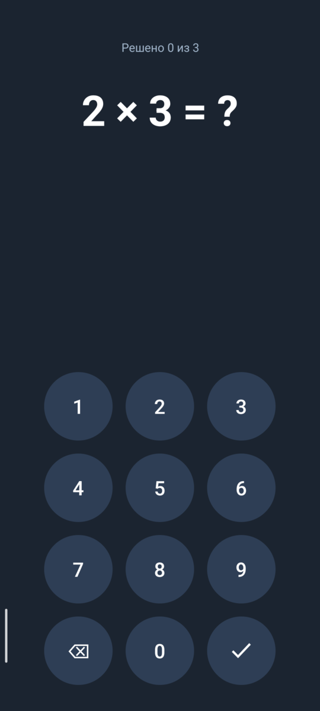
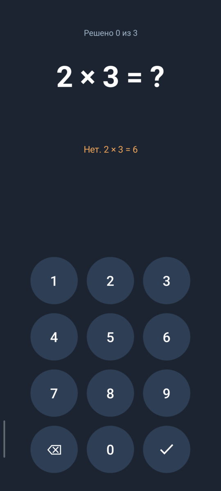
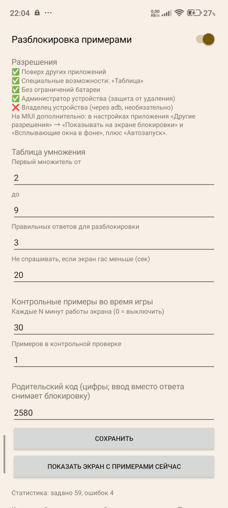

# Таблица (mathlock)

Детский экран блокировки для Android: вместо PIN-кода телефон разблокируется
случайными примерами из таблицы умножения.

*Android lock screen for kids: the phone unlocks by solving multiplication-table
problems or by reading a text aloud (offline speech recognition) instead of a PIN.
Optional daily screen-time limit with minutes earned by tasks. Java; the reading
mode uses ONNX Runtime (CPU or Qualcomm NPU).*

Сейчас в коде версия **0.5.1** (18.11.2026). Последний опубликованный релиз с APK —
[v0.2.0](https://github.com/fedor35/mathlock/releases/tag/v0.2.0): только примеры, без
чтения и дневного времени. Скриншоты ниже сняты с 0.2.0.

| Экран блокировки | Неверный ответ | Настройки |
|:---:|:---:|:---:|
|  |  |  |

## Установка

Готовый APK — в [Releases](https://github.com/fedor35/mathlock/releases/latest)
(Android 8.0+). После установки открыть «Таблица», выдать разрешения кнопками в
приложении, включить «Разблокировка примерами» и сменить родительский код.
Системную блокировку перевести в «Провести по экрану» — иначе после примеров
телефон всё равно спросит PIN.

## Как устроено

- Системная блокировка переводится в «Провести по экрану» (без PIN).
- Служба переднего плана следит за экраном: погас → телефон «заблокирован»;
  включился → поверх экрана блокировки показывается `QuizActivity` с примерами.
- Служба специальных возможностей (`WatchService`) возвращает примеры, если
  ребёнок нажал «Домой» или «Недавние». Содержимое экранов не читается.
- Если приложение остановится, телефон просто откроется без примеров.
- Родительский код (по умолчанию 2580) вводится вместо ответа и снимает блокировку.
- Если включить приложение владельцем устройства (`dpm set-device-owner`), экран
  с примерами пинится намертво. На телефонах с аккаунтами это недоступно.

Вместо примеров можно задать **чтение текста вслух** (или вперемешку): распознавание речи на самом телефоне, без
интернета; если модели не установлены или микрофон недоступен — всегда примеры. Подробно — [docs/READING.md](docs/READING.md).

Настройки: диапазон первого множителя, число правильных ответов, льготный период
(короткое гашение экрана не спрашивает примеры), родительский код, статистика ошибок.

Что добавилось после 0.2.0 (подробно — в истории коммитов):

- трудные примеры выпадают чаще (по каждому примеру ведётся счёт ответов), у родителя —
  сетка «как выучена таблица»;
- чтение вслух с уровнями сложности, опознанием чтеца по голосу и наградами;
- потолок громкости медиа по времени суток (вечер и ночь — тише, часы настраиваются);
- **дневное время телефона** (по умолчанию выключено): база + минуты, заработанные
  примерами и чтением; когда время вышло — экран с «Почитать» и «Позвонить», звонки не
  перекрываются;
- защита Настроек родительским кодом, пропуск после кода переживает только текущую загрузку.

## Устройство репозитория

| Путь | Что |
| --- | --- |
| `android/app` | Приложение «Таблица» (`dev.gubenkov.mathlock`): службы блокировки, экран заданий, настройки |
| `android/reading` | Движок чтения без UI: распознавание (ONNX Runtime, CPU/QNN), сверка с текстом, профили чтецов |
| `android/readbench` | Отдельное приложение-стенд для замеров распознавания |
| `content/ru/texts.jsonl` | Тексты для чтения по уровням |
| `ml/` | Экспорт и квантование моделей, озвучка, оценка сверки, сборка пакета чтения, стенд на телефоне |
| `docs/READING.md` | Как устроен режим чтения, замеры, решения |
| `docs/STRESS.md` | Исследование: распознавание ударений |

Модели распознавания и озвучка в репозиторий не входят: их собирает
`ml/make_reading_pack.sh` в отдельный пакет, который приложение загружает из папки
на телефоне ([docs/READING.md](docs/READING.md), раздел «В «Таблице»»). Без пакета
приложение работает только с примерами.

## Сборка и тесты

```
cd android
export JAVA_HOME=/usr/lib/jvm/java-17-openjdk   # с JDK 8 gradle не запускается
./gradlew :app:assembleDebug                    # отладочная сборка
./gradlew -PdevCopy :app:assembleDebug          # копия dev.gubenkov.mathlock.dev рядом с рабочей
./gradlew test                                  # JUnit-тесты app и reading
```

Подписанный релиз — `assembleRelease` с переменными `MATHLOCK_KEYSTORE` и
`MATHLOCK_KEYSTORE_PASSWORD` (ключ хранится вне репозитория). Чтение работает только
на arm64; APK с ONNX Runtime и QNN — около 74 МБ.

Выдача разрешений через adb (без них тоже можно, кнопками в приложении):

```
P=dev.gubenkov.mathlock
adb install -r -g app-debug.apk
adb shell appops set $P SYSTEM_ALERT_WINDOW allow
adb shell dumpsys deviceidle whitelist +$P
adb shell settings put secure enabled_accessibility_services $P/$P.WatchService
adb shell settings put secure accessibility_enabled 1
adb shell locksettings clear --old <старый PIN>
```

## На каком телефоне проверено

### Xiaomi 13 Lite — основной с 31.10.2026

| | |
|---|---|
| Телефон | Xiaomi 13 Lite (2210129SG), Snapdragon 7 Gen 1 (NPU Hexagon v69) |
| Система | HyperOS 3.0, Android 15, детский аккаунт под Family Link |
| Версии | 0.2.0 (31.10), 0.3.0 с чтением (05.11), далее каждая версия до 0.5.1 (18.11) |

Проверено: блокировка после включения экрана и после перезагрузки, чтение вслух на NPU
(подготовка модели под NPU — около 5 минут, один раз), в 0.5.1 — код на настройках,
начисление минут за прочитанный текст. Экран «время вышло», звонок поверх него и смена
суток на телефоне ещё не проверены.

Особенности Android 15 / HyperOS 3:

- после перезагрузки служба спецвозможностей выключалась, пока не выдано
  `adb shell appops set dev.gubenkov.mathlock ACCESS_RESTRICTED_SETTINGS allow`;
- при графическом ключе служба не стартует до ввода ключа — системная блокировка должна быть «свайп»;
- `adb install -r` иногда сбрасывает службу спецвозможностей: после установки проверить
  `adb shell dumpsys accessibility | grep Bound` и при необходимости включить заново.

Не проверено на 13 Lite: поведение при остановке службы и родительский выход в 0.5.x.

### Xiaomi Redmi Note 11 — 04.10–31.10.2026

| | |
|---|---|
| Телефон | Xiaomi Redmi Note 11 (2201117TG, spes), Snapdragon 680, 4 ГБ ОЗУ |
| Система | HyperOS 1.0 (V816.0.8.0.TGCMIXM), Android 13 |
| Особенности | 4 Google-аккаунта и Family Link (profile owner) — владельцем устройства приложение стать не может, поэтому работает через службу спецвозможностей |

Что проверено на нём (04.10 и 06.10.2026):

- после включения экрана кнопкой поверх экрана блокировки появляются примеры;
- «Домой» и «Недавние» не выпускают с экрана примеров;
- родительский код снимает блокировку;
- блокировка кнопкой не зажигает экран снова (исправлено 06.10.2026);
- после перезагрузки блокировка встаёт сама: HyperOS не доносит до приложения
  `BOOT_COMPLETED`, служба запускается из службы спецвозможностей;
- удалить приложение без кода нельзя (администратор устройства + код на вход в Настройки).

Особенности HyperOS: `am force-stop` и даже `adb install -r` выключают службу
спецвозможностей — после установки её нужно включить заново (команды выше).

Позже Redmi Note 11 использовался как стенд замеров распознавания на CPU (NPU нет).

На других телефонах не проверялось. Родительский код по умолчанию (2580) стоит
сменить в настройках сразу после установки.
